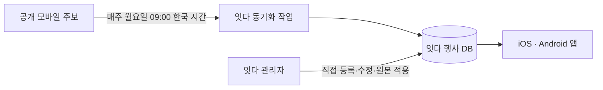

# 잇다 행사와 모바일 주보 동기화

잇다의 `events`와 `registrations`가 앱 조회·신청의 기준입니다. 주보는 외부 행사 원본이며, 앱이 열릴 때마다 원본 서버에 의존하지 않습니다. 잇다 자체 행사도 같은 DB에 등록합니다.



## 갱신 규칙

| 항목 | 동작 |
| --- | --- |
| 주간 자동 갱신 | `0 0 * * MON` UTC, 매주 월요일 한국 시간 오전 9시 |
| 즉시 가져오기 | 관리자 행사 운영 화면에서 실행 |
| 자동으로 가져오는 필드 | 제목, 종류, 공개 설명, 장소, 대상, 시작·종료·종일 여부 |
| 잇다에서만 관리하는 필드 | 공개 범위·게시 상태, 성도 조건, 추가 안내, 신청 설정·기한, 행사 취소·종료, 신청·출석 기록 |
| 직접 수정 | 원본 관리 필드를 실제로 바꾸면 해당 행사는 직접 관리로 전환 |
| 신청 설정만 수정 | 주보 자동 갱신을 유지 |
| 원본과 변경 충돌 | 최신 원본을 별도로 보관하고 확인이 필요한 변경으로 표시 |
| 자동 갱신 다시 켜기 | 최신 원본과 현재 값을 비교하고 명시적으로 적용. 버전이 바뀌면 다시 확인 |
| 원문에서 빠진 행사 | 삭제·취소하지 않고 관리자에게 누락 표시 |
| 수동 등록 행사 | 자동 동기화의 대상에서 제외 |
| 원본 서버 장애·잘못된 응답 | 기존 행사를 보존하고 동기화 실패 기록 |

같은 원본을 여러 번 가져와도 새 행사를 중복 생성하지 않습니다. 원본 ID와 별칭을 기록하고, 다음 주 주보에서 같은 제목과 정확한 일정이 반복되면 기존 행사에 연결합니다. 일정이 불명확한 안내는 자동으로 같은 행사라고 합치지 않습니다. 등록 ID와 신청·출석 기록은 유지합니다.

현재 운영 중인 공개 주보 응답에는 광고 ID가 없습니다. 이 경우 주보 ID와 정규화한 제목을 임시 식별자로 사용하며 경고를 남깁니다. 같은 주보 안에서 제목이 유지되면 내용·일정 변경을 추적합니다. 제목까지 바뀌었을 때 같은 행사라고 추측해 신청 기록을 옮기지는 않습니다. 주보 서버를 최신 코드로 배포해 광고 UUID가 공개되면 더 안정적으로 추적할 수 있습니다.

한 광고의 ‘홍보 기간’과 ‘행사 일시’를 각각 행사로 만들지 않습니다. 명시적인 행사 일시를 우선하고 신청기간을 행사 일시로 오인하지 않습니다. 모집 광고는 모집기간으로 표시합니다. 모호한 일정은 작성 중 상태로 가져와 관리자 검토를 받습니다. 새로 가져온 행사에서 앱 신청은 기본으로 꺼져 있습니다.

## 로컬 실행

```sh
npm run setup:itda
npm run sync:itda
npm run dev:itda
```

`setup:itda`는 로컬 DB에만 동작합니다. `sync:itda`는 공식 공개 주보를 읽어 로컬 잇다 DB에 실제 동기화를 한 번 실행합니다. 관리자 계정을 연결한 뒤 앱의 ‘행사 운영’에서도 실행할 수 있습니다.

`wrangler dev`는 설정된 주간 작업을 시간에 맞춰 자동 실행하지 않습니다. Local Explorer에서 Cron Trigger를 한 번 실행해 scheduled handler를 검증하거나 아래의 로컬 테스트 경로를 사용합니다.

```sh
curl 'http://localhost:8787/cdn-cgi/local/scheduled?cron=0%200%20*%20*%20MON&format=json'
```

## 운영 반영

1. 잇다 DB를 백업하고 기존 인증/행사 스키마 뒤에 `apps/api/db/event-sync-schema.sql`을 적용합니다.
2. `apps/api/wrangler.itda.example.jsonc`를 별도 운영 설정으로 복사합니다. 잇다 주소, Hyperdrive와 미디어 바인딩을 실제 값으로 바꿉니다. 주보 원본 서버와 다른 잇다 Worker를 사용합니다.
3. 기존 OAuth/세션 비밀값을 잇다 Worker에 설정합니다. `BULLETIN_SOURCE_ORIGIN`은 주보의 HTTPS 원본 주소입니다. 요청에서 임의 URL을 받아 가져오지 않습니다.
4. 해당 설정으로 dry-run 빌드를 검증하고 배포합니다. 이때 Cron Trigger가 등록됩니다. 원본 주보 Worker의 기존 배포 설정은 바꾸지 않습니다.
5. 모바일 앱의 `EXPO_PUBLIC_API_URL`을 잇다 API 주소로 지정합니다. 주보 원본 주소를 넣지 않습니다.
6. 관리자 화면의 ‘지금 가져오기’로 최초 데이터를 받은 뒤 마지막 성공 시각과 처리 결과를 확인합니다.

저장소의 예제에 설정을 추가하는 것만으로 실제 운영 작업이 등록되지는 않습니다. 이번 구현에서는 운영 서비스에 배포하지 않았습니다.

## 검증

```sh
ACCOUNT_TEST_DATABASE_URL=postgres://USER@127.0.0.1:6547/itda_test EVENT_TEST_DATABASE_URL=postgres://USER@127.0.0.1:6547/itda_test npm test
npm run build:itda
```

동기화 DB 테스트는 `EVENT_TEST_DATABASE_URL`을 사용합니다. 테스트는 별도 스키마를 만들고 정리하며 실제 운영 DB에 연결하지 않습니다.
